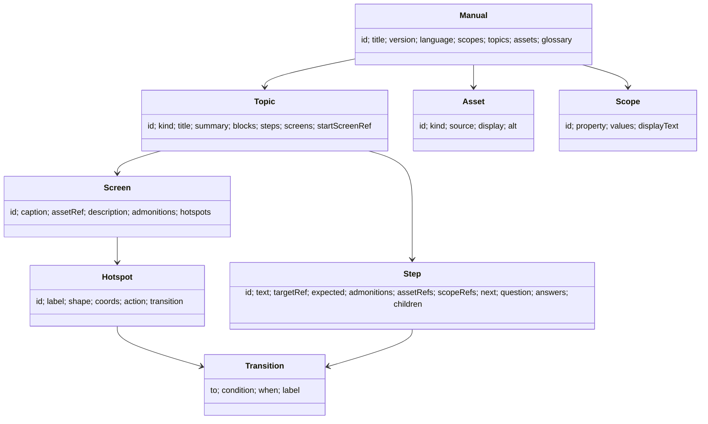

# @shuji-bonji/experiential-manual-model

画面や機器の操作を体験しながら学べる「体験型操作マニュアル」の共通データモデルです。作成ツールと閲覧ソフトがこの形でデータを読み書きし、S1000D のデータモジュールへの変換は別のパッケージ（`s1000d-writer-mcp`）が行います。このパッケージ自体は S1000D に依存せず、S1000D の用語も使いません。

## 入っているもの

| 内容 | 場所 |
|---|---|
| TypeScript の型（`Manual` / `Topic` / `Step` / `Screen` / `Hotspot` / `Transition` / `Asset` / `Scope` / `Admonition` / `Term`） | `src/types.ts` |
| JSON Schema（draft 2020-12） | `schema/manual.schema.json`（`@shuji-bonji/experiential-manual-model/schema/manual.schema.json` でも読めます） |
| 検査 `validateManual(json)` — 形の誤り・参照切れ・id の重複を `errors`、到達できない画面や未使用の素材を `warnings` で返します。実行時の依存はありません | `src/validate.ts` |
| 2021 年の作品 [experience_based_operation_explanation](https://github.com/shuji-bonji/experience_based_operation_explanation) の `JSON.json` を読む `fromLegacyJson(json)` | `src/legacy.ts` |
| 手順の番号（1、1.1、…）を組み立てる `numberSteps(steps)` | `src/number.ts` |
| 券売機の例 | `examples/kenbaiki.manual.json` |

## モデル



- `Topic.kind` は `description`（説明文）、`procedure`（手順）、`screenFlow`（画面と遷移）、`troubleshooting`（問いと答えで進む）の 4 つです。
- `Hotspot.coords` は HTML の `<area>` と同じ書き方です（`rect` は `[x1, y1, x2, y2]`、`circle` は `[cx, cy, r]`、`poly` は `[x1, y1, x2, y2, …]`）。
- `Scope` は「この機種」「屋外設置」のような適用範囲です。`Topic` / `Step` / `Block` / `Screen` が `scopeRefs` で参照します。
- `Asset.source` が原本、`Asset.display` が表示用の変換物です（3D の原本 JT と表示用の glTF、など）。
- 手順の番号は保存しません。`numberSteps` で表示時に組み立てます。

## 使い方

```ts
import { readFileSync } from 'node:fs';
import { validateManual, fromLegacyJson, numberSteps, type Manual } from '@shuji-bonji/experiential-manual-model';

const manual = JSON.parse(readFileSync('kenbaiki.manual.json', 'utf8')) as Manual;
const result = validateManual(manual);
if (!result.ok) console.error(result.errors);   // [{ path: '/topics/1/screens/0/hotspots/0/transition/to', message: '…' }]
console.log(result.warnings);                   // 到達できない画面、未使用の素材・適用範囲

// 2021 年の JSON.json を読む
const { manual: converted, warnings } = fromLegacyJson(JSON.parse(readFileSync('JSON.json', 'utf8')));

// 手順の番号
for (const { number, step } of numberSteps(manual.topics[2].steps!)) console.log(number, step.text);
```

## 2021 年の JSON との対応

| 2021 年の `JSON.json` | このモデル |
|---|---|
| `purchaseTypes[]`（README では `displayAreas[]`） | `Topic`（`kind: "screenFlow"`） |
| `titleID` / `title` / `description` | `Topic.id` / `title` / `summary` |
| `screens[]` の `screenID`（または `screenId`）/ `caption` / `description` / `imageUrl` | `Screen.id`（話題の id を接頭辞にして一意にする）/ `caption` / `description` / `assetRef` |
| `supplementaryExplanation` | `Screen.admonitions[{ level: "note" }]` |
| `buttons[]` の `name` / `shape` / `coords` / `destination`（または `screenTransitionDestination`） | `Hotspot.label` / `shape` / `coords` / `transition.to` |

`rect` の `coords` に 5 つ目の値が付いた button が 2 件あります。`fromLegacyJson` は捨てて `warnings` に書きます。

## 開発

```sh
npm install
npm test          # 検査・変換・JSON Schema（ajv は開発時だけの依存）
npm run build
```

## ライセンス

MIT
