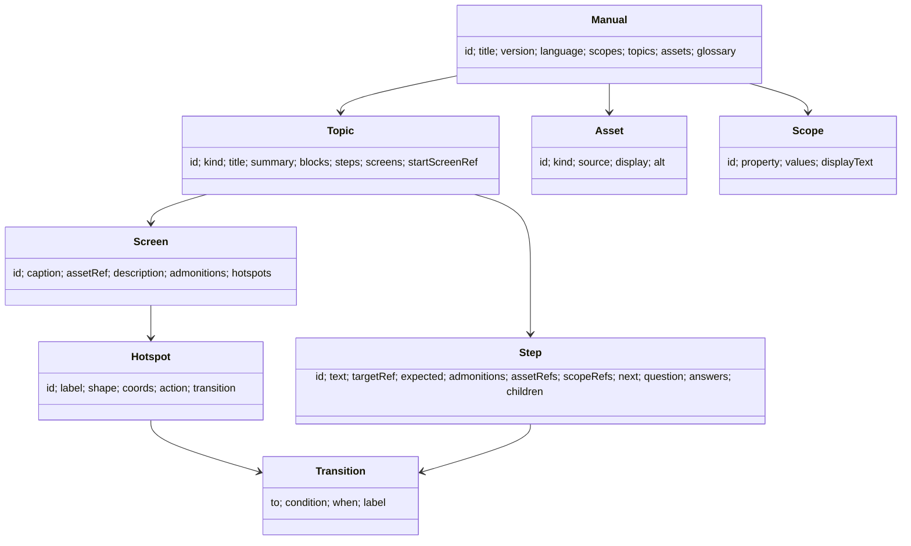

# @shuji-bonji/experiential-manual-model

**English** | [日本語](./README.ja.md)

A common data model for "experiential operation manuals", which let you learn how to operate a screen or a device by trying it out. The authoring tool and the viewer read and write data in this form; conversion to S1000D® data modules is done by a separate package (`s1000d-writer-mcp`). This package itself does not depend on S1000D and does not use S1000D terminology.

## What is included

| Content | Location |
|---|---|
| TypeScript types (`Manual` / `Topic` / `Step` / `Screen` / `Hotspot` / `Transition` / `Asset` / `Scope` / `Admonition` / `Term`) | `src/types.ts` |
| JSON Schema (draft 2020-12) | `schema/manual.schema.json` (also readable as `@shuji-bonji/experiential-manual-model/schema/manual.schema.json`) |
| Validation `validateManual(json)` — returns shape errors, broken references and duplicate ids in `errors`, and unreachable screens and unused assets in `warnings`. It has no runtime dependencies | `src/validate.ts` |
| `fromLegacyJson(json)`, which reads the `JSON.json` of the 2021 work [experience_based_operation_explanation](https://github.com/shuji-bonji/experience_based_operation_explanation) | `src/legacy.ts` |
| `numberSteps(steps)`, which builds procedure numbers (1, 1.1, …) | `src/number.ts` |
| Ticket machine example | `examples/kenbaiki.manual.json` |

## Model



- `Topic.kind` has 4 values: `description` (explanatory text), `procedure` (a procedure), `screenFlow` (screens and transitions) and `troubleshooting` (proceeds by question and answer).
- `Hotspot.coords` uses the same notation as the HTML `<area>` element (`rect` is `[x1, y1, x2, y2]`, `circle` is `[cx, cy, r]`, `poly` is `[x1, y1, x2, y2, …]`).
- `Scope` is a range of applicability such as "this model" or "outdoor installation". `Topic` / `Step` / `Block` / `Screen` refer to it through `scopeRefs`.
- `Asset.source` is the original, and `Asset.display` is the derived form used for display (for example, an original JT 3D model and a glTF for display).
- Procedure numbers are not stored. `numberSteps` builds them at display time.

## Usage

```ts
import { readFileSync } from 'node:fs';
import { validateManual, fromLegacyJson, numberSteps, type Manual } from '@shuji-bonji/experiential-manual-model';

const manual = JSON.parse(readFileSync('kenbaiki.manual.json', 'utf8')) as Manual;
const result = validateManual(manual);
if (!result.ok) console.error(result.errors);   // [{ path: '/topics/1/screens/0/hotspots/0/transition/to', message: '…' }]
console.log(result.warnings);                   // unreachable screens, unused assets and scopes

// Read the 2021 JSON.json
const { manual: converted, warnings } = fromLegacyJson(JSON.parse(readFileSync('JSON.json', 'utf8')));

// Procedure numbers
for (const { number, step } of numberSteps(manual.topics[2].steps!)) console.log(number, step.text);
```

## Mapping from the 2021 JSON

| 2021 `JSON.json` | This model |
|---|---|
| `purchaseTypes[]` (`displayAreas[]` in its README) | `Topic` (`kind: "screenFlow"`) |
| `titleID` / `title` / `description` | `Topic.id` / `title` / `summary` |
| `screenID` (or `screenId`) / `caption` / `description` / `imageUrl` in `screens[]` | `Screen.id` (made unique by prefixing the topic id) / `caption` / `description` / `assetRef` |
| `supplementaryExplanation` | `Screen.admonitions[{ level: "note" }]` |
| `name` / `shape` / `coords` / `destination` (or `screenTransitionDestination`) in `buttons[]` | `Hotspot.label` / `shape` / `coords` / `transition.to` |

There are 2 buttons whose `rect` `coords` carry a fifth value. `fromLegacyJson` drops it and records it in `warnings`.

## Development

```sh
npm install
npm test          # validation, conversion, JSON Schema (ajv is a dev-only dependency)
npm run build
```

## License

MIT
